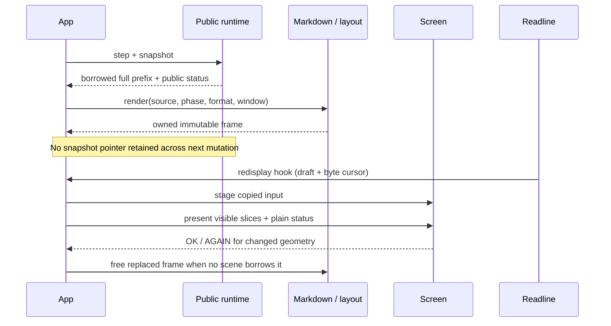

# Streaming Markdown scenario traces

Planning traces, not executed renderer tests. `md_render` below means
`cog_tui_markdown_render`; other names similarly abbreviate the draft APIs.
All render traces obtain a fresh public runtime snapshot while its borrow is
valid. `frame_view → screen_present → frame_free` borrows only immutable owned
rendered data. Each scenario must become executable before its shipping gate.

| # | Sequence / expected result | Header coverage | Gap disposition |
|---|---|---|---|
| 01 Ordinary stream | Cog prefix → md_render(STREAMING) → frame_view → scene → screen_present. One role label, continuous prose, input remains separate. | runtime.h snapshot; markdown.h render/view; screen.h present | App compositor supplies role labels outside Markdown; no per-chunk stdout writes. |
| 02 Open fence | Prefix with recognized code opener + content → parse EOF → code rows + provisional edge → present. | markdown.h phase/origin/row | EOF closure needs no fabricated source fence. Provisional edge is UI-only. |
| 03 Split opener | Prefix ends in two backticks → next prefix adds another and info → newline confirms opener → replace active frame. | markdown.h render/source | Do not freeze delimiter run length or hide ambiguous received text prematurely. |
| 04 Split close | Open code → possible closing run split across updates → final run or trailing nonspace proves interpretation → reparse. | markdown.h render | Reversible tail; test shorter runs, tildes, four-backtick opener and nested containers. |
| 05 Fence then prose | Code + actual closing fence + paragraph → new frame → present. | markdown.h run.style; screen.h present | Code attributes cannot leak to prose/status/prompt. |
| 06 Table header only | Pipe header → plain-looking prefix; delimiter arrives → reparse header + delimiter as table. | markdown.h render | Never manufacture a delimiter row. Whole active message may change. |
| 07 Partial delimiter rollback | Header + temporarily valid EOF delimiter → provisional table; append invalidating bytes → ordinary paragraph. | markdown.h row.provisional/view.preview_applied | Requires repaint, not append-only terminal output. |
| 08 Partial table body | Confirmed header/delimiter + half row → available cells/empty visual slots + provisional bottom edge → more bytes replace row/edge. | markdown.h run.origin/render | Visual completion is not an authored pipe, row or value. |
| 09 Growing table width | Table → longer cell arrives → measure all current cells → reflow table → scene present. | markdown.h window/view; screen.h present | Retain input and viewport anchor; coalesce redraws, do not cap earlier streaming widths irreversibly. |
| 10 Narrow table | resize → screen_resize(output geometry) → md_render(new window) → vertical header/value layout → present. | screen.h size/resize; markdown.h window/render | No invisible lost columns; wide resize can restore grid. |
| 11 Escaped pipes / overflow | Table with escaped pipe/code span/extra cells → parser/provenance adapter → preserve content or raw-table fallback. | markdown.h render(format) | GFM can discard overflow cells; adapter detection is a parser-selection gate. No naive `split('|')`. |
| 12 Inline preview | Supported open inline delimiter + content → optional virtual suffix → styled source runs, no suffix text → actual close/invalidating byte → regenerate. | markdown.h phase/origin/preview_applied | Start with literal unmatched inline syntax until suffix/provenance gate passes; no regex balancing. |
| 13 Incomplete link | Label + unfinished destination → literal tail → valid final syntax → safe link text. | markdown.h render/run | Never fabricate destination, request a URL, emit OSC8 or execute it. |
| 14 Nonlocal interpretation | Earlier reference usage → later definition arrives in same message → entire prefix reparsed → earlier rows update. | markdown.h source/render | No stable-prefix cache claim; cache only final messages. |
| 15 UTF-8 split | Prefix ends mid-character → pending_utf8_bytes > 0 → next prefix completes it → one supported cluster rendered. | markdown.h source/view | Final malformed suffix becomes visible replacement; no authored byte mutation. |
| 16 Hostile controls | Markdown with ESC/OSC/C0/C1, NUL or controls decoded from entities → sanitize after parse → safe runs → present. | markdown.h run; screen.h present | Both pre-parser policy and post-decode sanitation need tests. No bypass via code/links. |
| 17 Draft/cursor during stream | readline edits → screen_input(copy) ⇄ updated md frame → screen_present → more editing/acceptance. | screen.h input/present | Single physical screen writer. Custom redisplay alone does not cover all readline outputs; M2 probes them. |
| 18 Resize race | Geometry A → frame(A) → terminal changes to B → present returns AGAIN → resize → reflow → present(B). | screen.h resize/present; markdown.h window | Readline byte cursor survives; physical width is distinct from output width. |
| 19 Commit identity | active node_id=0/message key K → committed node_id=N/same key K → terminal-phase render → cache. | runtime.h snapshot; markdown.h source.phase/key | Do not duplicate text or treat an active INCOMPLETE aggregate as terminal. Phase-only changes invalidate frames. |
| 20 Cancel/failure | cancel request → keep STREAMING → Cog terminal snapshot → render(CANCELLED/FAILED) exact source → status line. | runtime.h cancel/step/snapshot; markdown.h phase; screen.h scene.status | Remove speculative inline fixes; preserve partial output and explicit outcome, no automatic replay. |
| 21 Limit/OOM | parse LIMIT → render(PLAIN, bounded window) → plain-view notice; allocation failure → retain last good frame + stale notice. | markdown.h limits/format/window; screen.h scene.status | Last-good frame lifetime is independent; fixed-buffer notice/clean shutdown if even fallback cannot allocate. |
| 22 Scroll and reflow | User pauses follow-tail → source grows → render anchored message slice → present without snapping to tail → resize/reclassification gives best-effort row anchor. | markdown.h view.first_row/total_rows; screen.h slices | Exact source-position anchoring is deferred, not promised by callbacks. |
| 23 Multi-message scene | Current snapshot → cached final frames + active frame + plain user frame → visible slices/role labels → one present transaction. | markdown.h frame_view/window; screen.h scene/slice | Exposed single-message present was insufficient in pass 1; scene contract added in pass 2. |
| 24 Backend teardown | Screen open → supported editing/updates → EOF/SIGINT/SIGTERM → drain runtime → screen_close → close streams. | screen.h open/close; runtime.h shutdown/free | Restore hooks, modes and signal ownership, consume screen on IO failure; no curses in handlers. |
| 25 Chunk invariance | Every split/partition → render(prefix) repeatedly → terminal COMPLETE → compare fresh exact-source batch frame. | markdown.h render/frame_view | Byte-identical normalized final frame at same dialect/width; synthetic state never accumulates. |
| 26 Terminal capability limits | No colors/ASCII-only/tiny geometry → resize/capability selection → plain styles/borders or compact resize notice. | screen.h backend/size/present | Never write outside windows; unavailable ncurses returns UNSUPPORTED, no implicit Cog work. |

Shared lifecycle trace:

Test grouping: 02–16/25 are pure parser/layout prefix fixtures; 01/17–24/26
require screen/PTY integration; 09/14/21 additionally need performance/limit
probes. These grouping assignments are a plan, not current executable coverage.
